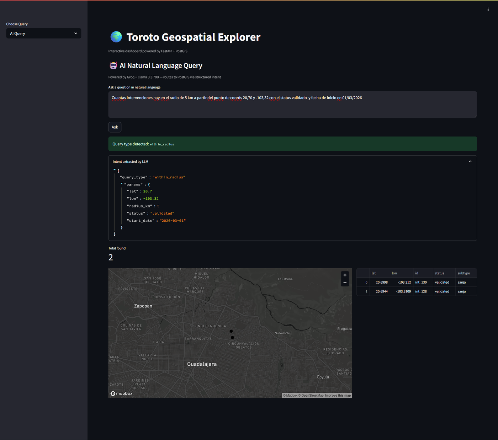
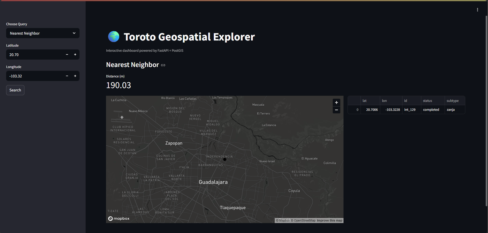
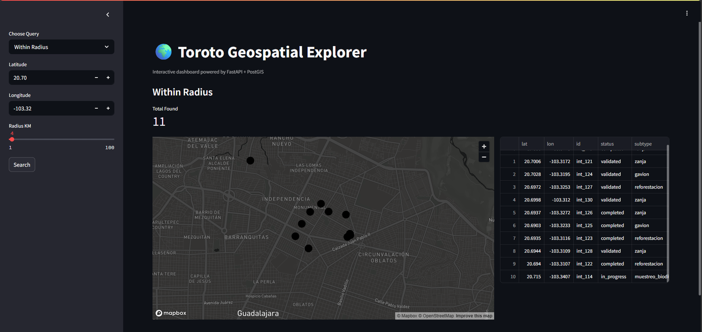
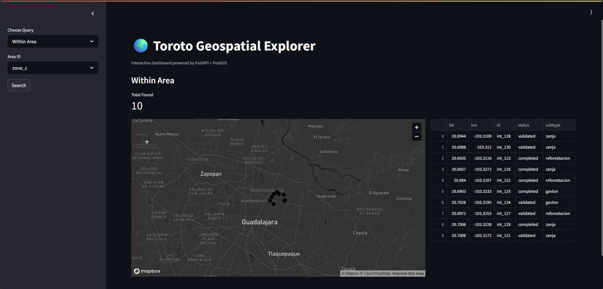

# Toroto Geospatial Explorer

REST API for storing and querying geospatial interventions, built with **FastAPI + PostgreSQL/PostGIS**, with an interactive Streamlit dashboard and an AI-powered natural language query layer.

> Small personal project. Run it locally with `docker-compose up --build` (it was hosted on Render's free tier and is now offline).

## Screenshots

**AI Query Layer** — a natural-language question (in Spanish here) is turned into a structured intent by the LLM, then routed to a predefined PostGIS query:



<table>
  <tr>
    <td><b>Nearest neighbor</b><br></td>
    <td><b>Within radius</b><br></td>
  </tr>
  <tr>
    <td colspan="2"><b>Within area (polygon)</b><br></td>
  </tr>
</table>

---

## Run locally

```bash
docker-compose up --build
```

- API + Swagger: http://localhost:8000/docs
- Dashboard: http://localhost:8501

Data loads automatically on startup:

```
✅ Loaded 130 interventions and 3 areas into PostGIS
```

### Environment variables

```bash
DATABASE_URL=postgresql://toroto:toroto@db:5432/geospatial
BASE_URL=http://api:8000/api/v1
GROQ_API_KEY=your_key_here   # required for AI Query Layer
```

Copy `.env.example` to `.env` and fill in `GROQ_API_KEY`.

---

## Architecture

```
┌─────────────┐     HTTP       ┌──────────────────────────────────────┐
│  Streamlit  │ ────────────►  │  FastAPI                             │
└─────────────┘                │                                      │
                               │  routes.py      (HTTP layer)         │
                               │      │                               │
                               │  repository.py  (spatial queries)    │
                               │      │                               │
                               │  database.py    (connections/init)   │
                               └──────────────┬───────────────────────┘
                                              │ SQLAlchemy + GeoAlchemy2
                               ┌──────────────▼───────────────────────┐
                               │  PostgreSQL + PostGIS                │
                               │  interventions  (POINT, 4326)        │
                               │  areas          (POLYGON, 4326)      │
                               └──────────────────────────────────────┘
```

| Layer | Responsibility |
|-------|---------------|
| `routes.py` | HTTP parsing, validation, response shaping |
| `repository.py` | All SQL and PostGIS spatial query logic |
| `database.py` | Connection management, table and index creation |
| `models.py` | SQLAlchemy + GeoAlchemy2 table definitions |
| `schemas.py` | Pydantic input/output contracts |
| `ai_query.py` | Natural language → intent JSON → repository function |

---

## Database Model

```sql
interventions
├── id                     TEXT PRIMARY KEY
├── subtype                TEXT              -- gavion, reforestacion, etc.
├── status                 TEXT              -- in_progress, validated, etc.
├── project_id             TEXT
├── region                 TEXT
├── geom                   geometry(POINT, 4326)   ← GIST indexed
├── date                   TEXT
├── intervention_timestamp TIMESTAMPTZ
├── operator_id            TEXT
├── priority               TEXT
├── quality_score          FLOAT
├── extra_metadata         JSONB
└── metrics                JSONB             -- flexible per-subtype metrics

areas
├── area_id  TEXT PRIMARY KEY
├── name     TEXT
└── geom     geometry(POLYGON, 4326)         ← GIST indexed
```

**JSONB for metrics** — different subtypes have different metrics (`area_m2` for gavion, `trees_planted` for reforestacion). JSONB avoids a sparse table or EAV pattern while keeping flexibility.

**SRID 4326 + geography cast** — all distance calculations cast to `geography` for accurate geodesic distances in meters on the WGS84 ellipsoid, avoiding planar distortion in degrees.

---

## Spatial Queries

### 1. Nearest Neighbor — `GET /api/v1/interventions/nearest`

```sql
SELECT *, ST_Distance(geom::geography, ref::geography) AS distance_m
FROM interventions
ORDER BY geom <-> ST_SetSRID(ST_MakePoint(:lon, :lat), 4326)
LIMIT 1
```

The `<->` KNN operator uses the GIST index directly — O(log n), no full table scan.

```bash
curl "http://localhost:8000/api/v1/interventions/nearest?lat=20.701&lon=-103.321"
```

---

### 2. Within Radius — `GET /api/v1/interventions/within-radius`

```sql
SELECT *, ST_Distance(geom::geography, ref::geography) AS distance_m
FROM interventions
WHERE ST_DWithin(geom::geography, ref::geography, :radius_m)
ORDER BY distance_m
```

`ST_DWithin` with `::geography` computes true geodesic distance. GIST provides a bounding-box pre-filter before the exact check.

```bash
curl "http://localhost:8000/api/v1/interventions/within-radius?lat=20.700&lon=-103.320&radius_km=5"
curl "http://localhost:8000/api/v1/interventions/within-radius?lat=20.700&lon=-103.320&radius_km=5&start_date=2026-03-01&end_date=2026-03-31"
```

---

### 3. Within Area — `GET /api/v1/interventions/within-area/{area_id}`

```sql
SELECT i.*
FROM interventions i
JOIN areas a ON ST_Within(i.geom, a.geom)
WHERE a.area_id = :area_id
```

`ST_Within` implements the DE-9IM spatial predicate. GIST indexes on both geometries: bounding-box pre-filter + exact topological test.

```bash
curl "http://localhost:8000/api/v1/interventions/within-area/zone_a"
curl "http://localhost:8000/api/v1/interventions/within-area/zone_c?status=validated"
```

---

## All Endpoints

| Method | Path | Description |
|--------|------|-------------|
| GET | `/api/v1/interventions/nearest` | Nearest neighbor |
| GET | `/api/v1/interventions/within-radius` | Within radius (km) |
| GET | `/api/v1/interventions/within-area/{area_id}` | Within polygon |
| GET | `/api/v1/interventions` | List with filters |
| GET | `/api/v1/areas` | List reference polygons |
| GET | `/api/v1/status-summary` | Count by status |
| GET | `/api/v1/subtype-by-region` | Count by region + subtype |
| GET | `/api/v1/analytics/by-region` | Analytics by region |
| GET | `/api/v1/analytics/by-subtype` | Analytics by subtype |
| GET | `/api/v1/analytics/timeline` | Monthly timeline |
| POST | `/api/v1/query` | Natural language query (AI) |
| GET | `/health` | Health check |

---

## AI Query Layer

Natural language queries are interpreted by **Groq + Llama 3.3 70B** and routed to existing spatial functions. The LLM never generates raw SQL — it extracts a structured intent JSON that maps to a predefined function in `repository.py`.

```bash
curl -X POST "http://localhost:8000/api/v1/query" \
  -H "Content-Type: application/json" \
  -d '{"question": "Which validated interventions are within 5km of 20.7, -103.3?"}'
```

**Intent flow:**
```
Natural language → LLM → { query_type, params } → repository.py → PostGIS
```

Example of the intent extracted for the question in the screenshot above:

```json
{
  "query_type": "within_radius",
  "params": { "lat": 20.7, "lon": -103.32, "radius_km": 5, "status": "validated", "start_date": "2026-03-01" }
}
```

---

## Technical Decisions

| Decision | Choice | Reason |
|----------|--------|--------|
| Database | PostgreSQL + PostGIS | Native spatial operators, GIST indexes, geography type |
| Distance calculation | `::geography` cast | Geodesic accuracy on WGS84 ellipsoid |
| Nearest neighbor | `<->` KNN operator | GIST index — no full table scan |
| API framework | FastAPI | Async, automatic OpenAPI docs, Pydantic validation |
| Metrics storage | JSONB | Flexible schema per intervention subtype |
| AI layer | LLM → intent → function | Safe (no SQL injection surface), precise, reuses existing endpoints |
| LLM provider | Groq + Llama 3.3 70B | Free tier, high throughput, OpenAI-compatible API |
| Containerization | Docker Compose | Zero-config local setup |
| Deployment | Render (free tier, now offline) | Managed PostgreSQL with PostGIS |

---

## Known Limitations

- `_build_filters()` uses string interpolation in some cases — should be fully parameterized in production
- No authentication layer
- No pagination on large result sets
- AI layer supports a fixed set of query types; out-of-catalog questions return an error
- No RAG, embeddings or agent workflows — the LLM is used only for intent extraction

## Scale Path

- `CLUSTER interventions USING idx_interventions_geom` for physical spatial ordering
- Partition table by `region` or `date` for large datasets
- PgBouncer connection pool + read replicas for query scaling
- Migrate to Cloud Run + Cloud SQL for serverless deployment on GCP
- Abstract LLM call behind an interface for provider swap (Groq ↔ OpenAI ↔ Ollama)
